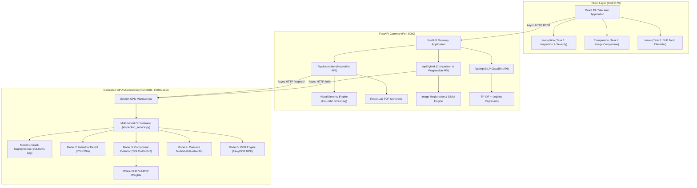

# Autonomous AI Inspection, Visual Comparison & NLP Assessment System

[](https://www.python.org/)
[](https://pytorch.org/)
[](https://fastapi.tiangolo.com/)
[](https://react.dev/)
[](https://vitejs.dev/)
[-76B900.svg)](https://developer.nvidia.com/cuda-toolkit)
[](https://opensource.org/licenses/MIT)

AI assessment platform **dual-domain visual inspection and severity screening**, **feature-based before/after image comparison with hybrid crack progression analysis**, and **interpretable natural language news classification**.

---

## 1. Project Overview & Objectives

This repository contains the completed, fully integrated implementation of an AI/ML technical evaluation addressing three distinct core competencies:

1. **Task 1 — AI Damage Detection & Visual Inspection**:
   - Automated defect detection and crack segmentation for **Building Structural Elements** (concrete cracks, spallation, exposed rebar, efflorescence) and **Industrial Machinery** (corrosion, metal fractures, mechanical slippage).
   - Zero-shot component localization via open-vocabulary detection.
   - On-device Optical Character Recognition (OCR) for equipment nameplates and serial numbers.
   - Explainable visual severity evaluation and inspection prioritization.
   - Publication-ready PDF and structured JSON inspection reporting.
2. **Task 2 — Before/After Image Comparison**:
   - Robust feature-based image registration (SIFT, AKAZE, ORB) with homography estimation and RANSAC outlier rejection.
   - Structural Similarity Index (SSIM) change detection and visual difference heatmaps.
   - **Additional Capability**: Hybrid temporal crack progression engine that decomposes structural change into newly observed fractures, persistent cracks, and resolved regions with metric calibration.
3. **Task 3 — NLP News Topic Classification**:
   - Supervised classification across 4 topical domains (`World`, `Sports`, `Business`, `Sci/Tech`).
   - High-throughput TF-IDF vectorization with regularized Logistic Regression.
   - Full prediction confidence distributions and token interpretability.

---

## 2. Technology Stack

| Domain | Technologies & Libraries |
|---|---|
| **Frontend Single-Page App** | React 19, Vite, Tailwind CSS, Axios, Lucide Icons |
| **Gateway Microservice** | FastAPI, Uvicorn, Pydantic v2, ReportLab, NumPy, Scikit-learn, OpenCV |
| **GPU Inference Microservice** | Python 3.12, PyTorch 2.6.0+cu124, Ultralytics 8.4 (YOLO), EasyOCR, Pillow |
| **Computer Vision Models** | YOLO26s-seg, YOLO26s, YOLOv8s-worldv2, ResNet18 (CODEBRIM), CRAFT + BiLSTM-CTC |
| **NLP Pipeline** | Scikit-Learn TF-IDF Vectorizer + Multinomial Logistic Regression |
| **Hardware Target** | NVIDIA GeForce RTX 4060 Laptop GPU (8 GB VRAM, Compute 8.9) |

---

## 3. System Architecture & Topology



---

## 4. AI Models Deployed

All model checkpoints are preserved in the repository and verified bit-for-bit:

| Model | Architecture | File Path | Parameters / Size | SHA-256 Hash |
|---|---|---|---|---|
| **Crack Segmentation** | YOLO26s-seg | `backend/models/damage/crack_segmentation_best.pt` | 22.26 MB | `cffe2ec06b921dc6374a2714644dd5c907c3eeded6bdd81988cd5e7f0130ec32` |
| **Industrial Defect** | YOLO26s | `backend/models/damage/industrial_defect_yolo26s.pt` | 19.37 MB | `3013631424d4535b63efed04ea4d8968a7130421db7d43be1801c871dfea7685` |
| **CODEBRIM Multilabel** | ResNet18 | `backend/models/damage/codebrim_multilabel_best.pt` | 42.72 MB | `07d0dd2546b004ec9f47b5fac1569f3ea41ad3e91d0a5c8af1e90a1379df8e80` |
| **Component Detector** | YOLOv8s-worldv2 | `backend/models/yolov8s-worldv2.pt` | 24.72 MB | `9b2c17ab6124a913e9b3a5c170617920d91b0f01111a8479da69f00e2cf27792` |
| **News Classifier** | TF-IDF + LogReg | `backend/models/news_classifier.joblib` | 1.35 MB | `70c31204238c01f13f06c4efdc63ab322a857b8a6f64965f5df038443a11fc9b` |
| **CLIP Text Encoder** | ViT-B/32 | `weights/clip/ViT-B-32.pt` | 337.58 MB | `40d365715913c9da98579312b702a82c18be219cc2a73407c4526f58eba950af` |

*For complete input/output specifications, inference latencies, and limitations, refer to [docs/MODEL_INVENTORY.md](docs/MODEL_INVENTORY.md).*

---

## 5. Repository Structure

```
AI-Assessment/
├── .gitattributes                             # Git LFS tracking rules
├── .gitignore                                 # Clean exclusion rules
├── README.md                                  # System overview and runbook
├── backend/
│   ├── app/                                   # FastAPI Gateway (Port 8000)
│   │   ├── api/                               # Inspection, comparison, damage, nlp endpoints
│   │   ├── core/                              # App config and logging
│   │   ├── schemas/                           # Pydantic request/response schemas
│   │   ├── services/                          # Visual severity, ReportLab, SIFT/SSIM engines
│   │   └── main.py                            # Gateway entry point
│   ├── configs/                               # Service YAML configurations
│   ├── damage_inference/                      # GPU Microservice (Port 8001)
│   │   ├── app.py                             # Microservice entry point
│   │   ├── classifier_service.py              # ResNet18 GPU engine
│   │   ├── config.py                          # Path resolution logic
│   │   ├── geometry.py                        # Defect-to-component spatial association
│   │   ├── inspection_service.py              # Multi-model GPU orchestrator
│   │   └── schemas.py                         # Microservice schemas
│   ├── datasets/                              # Test fixtures & split manifests
│   │   ├── codebrim_splits/                   # Phase 2 split manifests (0.34 MB)
│   │   └── damage/                            # Test fixtures (112 test images)
│   ├── docs/                                  # Backend integration guides
│   ├── models/                                # Production Model Checkpoints (110.4 MB)
│   │   ├── damage/                            # Crack seg, industrial defect, ResNet18
│   │   ├── metrics.json                       # Task 3 NLP evaluation metrics
│   │   ├── news_classifier.joblib             # Task 3 NLP model
│   │   └── yolov8s-worldv2.pt                 # Open-vocabulary component detector
│   ├── requirements.txt                       # Gateway dependency lockfile
│   ├── requirements_yolo.txt                  # GPU microservice dependency lockfile
│   ├── scripts/                               # E2E validation & verification scripts
│   └── tests/                                 # 230 automated unit and regression tests
├── docs/                                      # Full Architectural Documentation
│   ├── ARCHITECTURE.md                        # Detailed architecture & pipeline flows
│   ├── MODEL_INVENTORY.md                     # Model specifications & provenance
│   ├── SUBMISSION_GUIDE.md                    # Git LFS & evaluator instructions
│   └── VERIFICATION_REPORT.md                 # Empirical test evidence & latencies
├── frontend/                                  # React 19 / Vite Web Application
│   ├── public/                                # Static assets
│   ├── src/                                   # Components, pages, and API services
│   ├── tests/                                 # 30 frontend unit tests
│   ├── package.json                           # npm dependency manifest
│   └── vite.config.js                         # Vite bundler config (Port 5173)
├── reports/
│   └── task1_final/                           # Phase deliverables & generated sample reports
│       ├── sample_building_inspection.json    # Sample building inspection JSON output
│       ├── sample_building_report.pdf         # Sample building inspection PDF report (929 KB)
│       ├── sample_industrial_inspection.json  # Sample industrial inspection JSON output
│       └── sample_industrial_report.pdf       # Sample industrial inspection PDF report (148 KB)
└── weights/
    └── clip/
        └── ViT-B-32.pt                        # Offline CLIP text encoder cache (337.6 MB)
```

---

## 6. Installation & Prerequisites

### 6.1 System Requirements
- **OS**: Windows 11 / Windows 10 (or Linux with CUDA 12+).
- **GPU**: NVIDIA GPU with $\ge 6\text{ GB}$ VRAM recommended (tested on RTX 4060 Laptop GPU, 8 GB VRAM).
- **Python**: Python 3.12 (for GPU Microservice) and Python 3.14 (or 3.12+) for Gateway.
- **Node.js**: $\ge 18.0$ (tested on Node.js v24.2.0).
- **Git LFS**: Required to clone model weights.

### 6.2 Clone with Git LFS
```bash
git lfs install
git clone https://github.com/<username>/AI-Assessment.git
cd AI-Assessment
git lfs pull
```

### 6.3 Setup Environments

#### Terminal A: Dedicated GPU Microservice (`backend/venv_yolo`)
```powershell
cd backend
py -3.12 -m venv venv_yolo
.\venv_yolo\Scripts\Activate.ps1
pip install --upgrade pip
pip install -r requirements_yolo.txt
deactivate
cd ..
```

#### Terminal B: FastAPI Gateway (`backend/venv`)
```powershell
cd backend
python -m venv venv
.\venv\Scripts\Activate.ps1
pip install --upgrade pip
pip install -r requirements.txt
deactivate
cd ..
```

#### Terminal C: React Frontend (`frontend/`)
```powershell
cd frontend
npm install
cd ..
```

---

## 7. Starting the Application

To launch all three services, start the components in separate PowerShell terminal windows.

### Terminal 1 — Start the Dedicated GPU Microservice (Port 8001)
From the repository root:
```powershell
.\backend\venv_yolo\Scripts\python.exe -m uvicorn damage_inference.app:app --app-dir backend --host 127.0.0.1 --port 8001
```
*Alternative (from inside `backend/` directory):*
```powershell
cd backend
.\venv_yolo\Scripts\python.exe -m uvicorn damage_inference.app:app --host 127.0.0.1 --port 8001
```
*Expected log:* `INFO: InspectionService core vision models successfully initialized.`

### Terminal 2 — Start the FastAPI Gateway (Port 8000)
From the repository root:
```powershell
.\backend\venv\Scripts\python.exe -m uvicorn app.main:app --app-dir backend --host 127.0.0.1 --port 8000 --reload
```
*Alternative (from inside `backend/` directory):*
```powershell
cd backend
.\venv\Scripts\python.exe -m uvicorn app.main:app --host 127.0.0.1 --port 8000 --reload
```
*Expected log:* `INFO: Application startup complete.`

### Terminal 3 — Start the React/Vite Frontend (Port 5173)
```powershell
cd frontend
npm run dev
```
*Expected log:* `VITE ready in ~180 ms. Local: http://localhost:5173/`

### Application Navigation & Direct URLs
Open your web browser at **`http://localhost:5173/`**:
- **Main Dashboard**: `http://localhost:5173/`
- **Task 1 — AI Visual Inspection & Severity**: `http://localhost:5173/inspection`
- **Task 2 — Before/After Image Comparison**: `http://localhost:5173/image-comparison` (or `/comparison`)
- **Additional Feature — Hybrid Crack Progression**: `http://localhost:5173/hybrid-analysis` (or `/hybrid`)
- **Task 3 — NLP News Topic Classification**: `http://localhost:5173/news-classification` (or `/news`)
- **System Health Diagnostics**: `http://localhost:5173/system-status`

---

## 8. Verifying & Running Tests

All automated unit, regression, and build suites can be executed independently:

```powershell
# 1. Run all Backend Gateway Tests (230 tests)
cd backend
.\venv\Scripts\python.exe -m pytest tests
# Result: 226 passed, 4 skipped in ~12s

# 2. Run GPU Microservice Tests (32 tests)
.\venv_yolo\Scripts\python.exe -m pytest tests/test_damage_service.py tests/test_damage_geometry.py
# Result: 32 passed in ~6s

# 3. Run Frontend Unit Tests (30 tests)
cd ../frontend
npm test
# Result: 30 passed, 0 failed

# 4. Compile Frontend Production Bundle
npm run build
# Result: ✓ built in ~700ms (2,543 modules)
```

---
