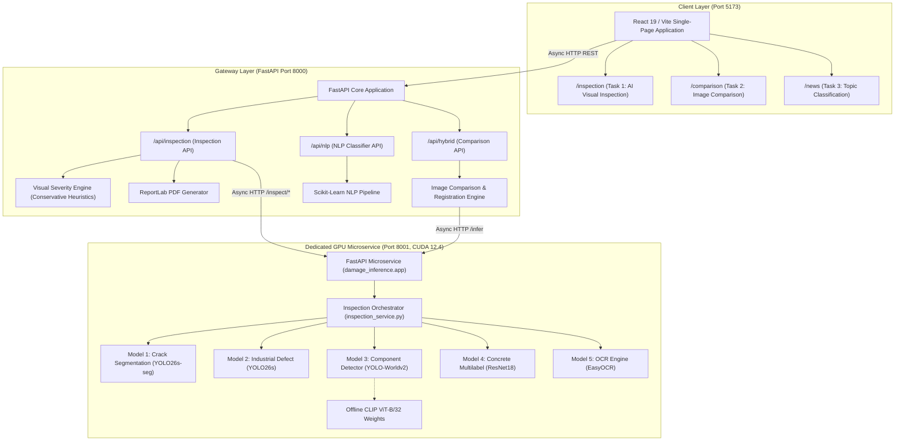

# System Architecture & Technical Specifications

## 1. System Topology & Service Decomposition

The application is architected as an asynchronous, distributed multi-service system designed to separate heavy GPU deep learning inference from high-concurrency client API routing and interactive UI rendering:

---

## 2. Assessment Task Capabilities & Workflows

### Task 1 — AI Damage Detection & Visual Inspection
- **Domain Selection**: The user selects **Building & Concrete** or **Industrial Equipment**.
- **Building Pipeline Flow**:
  1. Client uploads concrete surface photo to `POST /api/inspection/analyze`.
  2. Gateway streams payload to GPU Microservice (`POST /inspect/building`).
  3. YOLO26s-seg segments cracks and computes surface area percentage.
  4. ResNet18 classifies CODEBRIM categories (`Crack`, `Spallation`, `CorrosionStain`, `ExposedBars`, `Efflorescence`).
  5. YOLO-Worldv2 identifies structural components (`beam`, `column`, `wall`, `slab`, etc.).
  6. Spatial engine intersects crack bounding boxes with structural component contours.
  7. Gateway evaluates explainable visual severity and assigns inspection priority (`urgent`, `scheduled`, `monitor`, `review`).
  8. Layered overlays (combined, defects only, components only) are returned with structured JSON.
  9. User can download a formal, publication-ready PDF inspection report generated via ReportLab.
- **Industrial Pipeline Flow**:
  1. Client uploads equipment image to `POST /api/inspection/analyze`.
  2. YOLO26s detects `corrosion`, `metal_crack`, or `mechanical_slippage`.
  3. YOLO-Worldv2 detects equipment assets (`pipe`, `valve`, `flange`, `tank`, `pump`, `motor`, etc.).
  4. EasyOCR extracts serial numbers, warning tags, and operating ratings from nameplates.
  5. Visual Severity Engine evaluates surface defect percentage and elevates priority for active metal cracks.

### Task 2 — Before/After Image Comparison & Crack Progression
- **Image Registration Pipeline**:
  1. Before and After inspection photos are submitted to `POST /api/hybrid/compare`.
  2. Feature detection (SIFT, AKAZE, or ORB) extracts keypoints and descriptors.
  3. FLANN-based or Brute-Force matching pairs features across temporal frames.
  4. RANSAC computes a projective homography matrix $H$ to align the "before" image onto the "after" reference grid.
  5. Alignment quality telemetry is validated against strict geometric criteria (inlier ratio, condition number, reprojection error).
- **Difference & Progression Detection**:
  1. SSIM (Structural Similarity Index) computes radiometric differences.
  2. YOLO26s-seg segments crack masks in both temporal frames.
  3. Morphological change engine decomposes damage into **Newly Observed Cracks**, **Persistent Existing Cracks**, and **Apparent Healed/Resolved Regions**.
  4. Progression metrics (growth percentage, change area in $\text{mm}^2$ using metric calibration) are output alongside interactive split-screen visual overlays.

### Task 3 — NLP News Topic Classification
- **Classification Pipeline**:
  1. News article headline or text is submitted to `POST /api/nlp/classify`.
  2. Text preprocessor strips HTML markup, URLs, special punctuation, and normalizes whitespace.
  3. Fitted `TfidfVectorizer` extracts unigram and bigram feature representations.
  4. Calibrated `LogisticRegression` pipeline classifies the document into `World`, `Sports`, `Business`, or `Sci/Tech`.
  5. Output returns top predicted class, class probabilities, and diagnostic token indicators.

---

## 3. Communication Protocols & Fault Tolerance

1. **Inter-Service Communication**:
   - Gateway communicates with the GPU microservice via asynchronous non-blocking HTTP using `httpx.AsyncClient`.
   - Microservice failures trigger structured, human-readable HTTP 503 error payloads (`DAMAGE_SERVICE_UNAVAILABLE`) with remediation guidance rather than uncaught stack traces.
   - Inference timeouts are capped at 45 seconds (`DAMAGE_SERVICE_TIMEOUT`).
2. **Defect-to-Component Spatial Association**:
   - For every localized defect (crack or industrial anomaly), the engine computes the spatial intersection over the defect area with all candidate components:
     $$\text{Overlap} = \frac{\text{Area}(\text{Defect} \cap \text{Component})}{\text{Area}(\text{Defect})}$$
   - If $\text{Overlap} \ge 0.05$ (5%), the defect is associated with that specific component name. Otherwise, it is attributed to `"unknown"`.
   - Multi-label image classifications (e.g. from ResNet18) have $\text{bbox} = \text{None}$ to prevent fabricating false coordinates.
3. **Conservative Visual Screening Disclaimer**:
   - Automated visual analysis evaluates surface visual appearance from 2D RGB imagery alone.
   - The engine explicitly disclaims certified structural, mechanical, or safety assessments. It cannot evaluate internal stress, material fatigue, wall thickness, or imminent failure.
